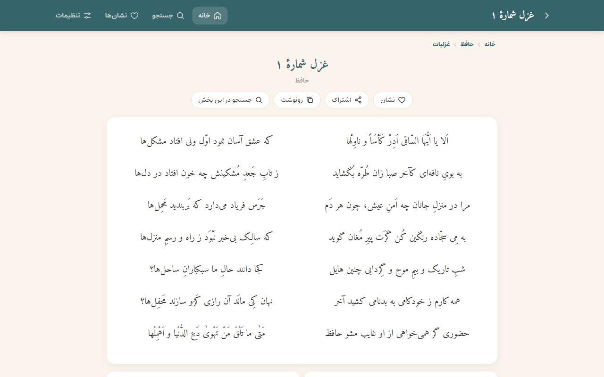
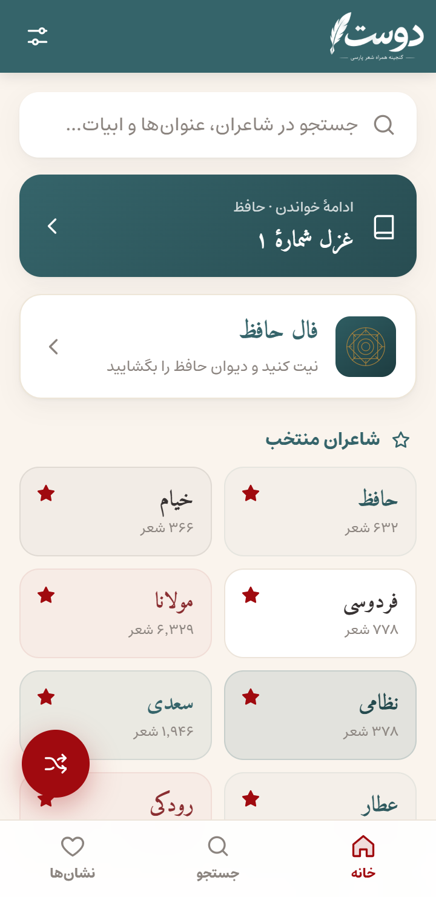
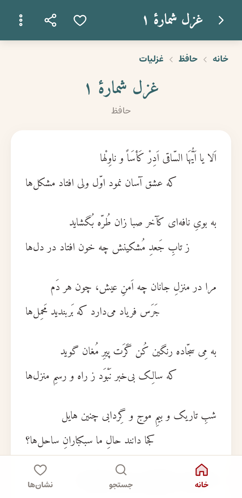
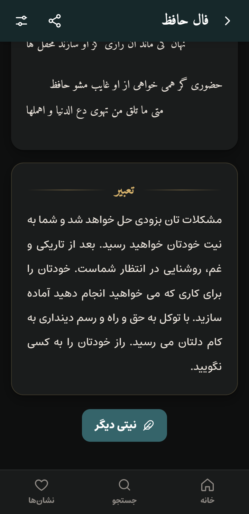

<div align="center">
  
  <h1>دوست · Doost</h1>
  <p><b>گنجینهٔ همراه شعر پارسی، سریع، سبک و کاملاً آفلاین</b><br/>
  A pocket library of Persian poetry: fast, lightweight and fully offline.</p>

  <p>
  <a href="https://shahind.github.io/Doost/"></a>
  <a href="https://github.com/shahind/Doost/releases/latest"></a>
  <a href="https://github.com/shahind/Doost/releases/latest"></a>
  <a href="https://github.com/shahind/Doost/releases/latest"></a>
  <a href="https://github.com/shahind/Doost/releases/latest"></a>
  <a href="https://cafebazaar.ir/app/com.shahinsoft.doost"></a>
  </p>

  
  <br/><br/>
  &nbsp;
  &nbsp;
  
</div>

## Download

| Platform | |
|---|---|
| Web | [shahind.github.io/Doost](https://shahind.github.io/Doost/), installable, works offline |
| Android | [Cafe Bazaar](https://cafebazaar.ir/app/com.shahinsoft.doost) or the `.apk` from [Releases](https://github.com/shahind/Doost/releases/latest) |
| iOS | unsigned `.ipa` from [Releases](https://github.com/shahind/Doost/releases/latest) (install with AltStore or Sideloadly) |
| Windows | installer or portable `.exe` from [Releases](https://github.com/shahind/Doost/releases/latest) |
| Linux | `.AppImage` or `.deb` from [Releases](https://github.com/shahind/Doost/releases/latest) |

## Features

- **237 poets and 133,000 poems** (3 million verses), from Hafez, Saadi, Rumi and Ferdowsi to modern poets.
- **Search everything**: poet names, poem titles and the text of every verse. Half-spaces and diacritics don't matter. Search all poets, one poet or one book.
- Poems in the traditional **couplet layout**.
- **Faal-e Hafez**: form your intention, open the Divan and read the ghazal with its interpretation.
- **Tap a word** to look up its meaning in the [Yaad](https://github.com/shahind/Yaad) dictionary.
- **Bookmarks**, continue reading where you left off, and sharing a verse or a poem as text or image.
- Light and dark themes, adjustable text size.
- **No internet needed**, no ads, no data collected.

---

## For developers

### Why it is fast and light

- The 341 MB SQLite database is packed into **63 MB** of compressed data, and the app no longer loads a whole database into memory.
- At startup the app reads only a **1 MB catalog**, in 100–250 ms. Verses are stored in small blocks and loaded only when needed. Persian text is re-encoded to one byte per letter before compression.
- Poems are stored in reading order, so the next poem is usually already loaded and "search in this poet" is just a range.
- Verse search uses a prefix-sharded word index in a Web Worker: **15–120 ms** per page of results, without blocking the screen.
- The fonts are subset WOFF2 files: 325 KB instead of 1.1 MB.

### Technology

Plain **JavaScript, HTML and CSS**, with no framework and no bundler. **Capacitor** wraps it for Android and iOS, and **Electron** for Windows and Linux. The data is built with **Node.js** scripts in `tools/`.

### Run, test, build

Needs Node.js 22+ and [Git LFS](https://git-lfs.com) (the source database is stored with it).

```bash
git lfs pull
npm install
npm run build:data   # build the poetry data into www/data
npm test             # search tests
npm run serve        # open http://localhost:5173
```

| Target | Command |
|---|---|
| Desktop app | `npm run electron` |
| Windows build | `npm run dist:win` |
| Linux build | `npm run dist:linux` |
| Android | `npm run android` (opens Android Studio) |
| iOS | `npm run ios` (opens Xcode, macOS only) |

## Credits

- Poetry: Ganjoor (گنجور), from [ganjoor/desktop](https://github.com/ganjoor/desktop) and [ganjoor/ganjoor-data](https://github.com/ganjoor/ganjoor-data).
- Fonts: Amiri and Estedad (SIL Open Font License).
- Code: [GNU GPL v3](LICENSE).
